<div align="center">


# iptime-cli

[English](README.md)

새 관리자 화면(펌웨어 16.x)을 쓰는 ipTIME 공유기를 터미널과 파이썬에서 읽고 설정하는 비공식 CLI·라이브러리입니다.

Python 3.9+ · no dependencies

[](https://pypi.org/project/iptime-cli/)
[](https://github.com/elfenomenokim/iptime-cli/blob/main/LICENSE)

[설치](#설치) · [빠르게 써 보기](#빠르게-써-보기) · [이 도구가 하는 일](#이-도구가-하는-일)

</div>

<p align="center">
<picture>
  <source media="(prefers-color-scheme: dark)" srcset="https://raw.githubusercontent.com/elfenomenokim/iptime-cli/main/docs/demo/iptime-dark.gif">
  <source media="(prefers-color-scheme: light)" srcset="https://raw.githubusercontent.com/elfenomenokim/iptime-cli/main/docs/demo/iptime-light.gif">
  
</picture>
</p>

## 설치

```console
$ pipx install iptime-cli
$ uv tool install iptime-cli
```

Python 3.9 이상이면 됩니다. 표준 라이브러리만 사용합니다.

## 빠르게 써 보기

`IPTIME_HOST`, `IPTIME_USER`, `IPTIME_PASSWORD`를 지정하거나 설정 파일에 저장하세요. 실제 공유기에 연결하기 전에 함께 들어 있는 가짜 공유기로 명령을 익힐 수 있습니다.

```console
$ iptime clients
IP            MAC                NAME        LINK          LEASE LEFT  RESERVED
192.168.0.10  AA:BB:CC:00:00:01  desktop     lan2 wired    static
192.168.0.11  AA:BB:CC:00:00:02  nas         lan4 wired    22h 13m     yes
192.168.0.20  AA:BB:CC:00:00:03  laptop      5g.1 -48 dBm  1h 46m

$ iptime info
Model            ipTIME FAKE-1000
Firmware         16.000  (built 2026.01.01 00:00:00)
Latest firmware  16.010  (update available)
Uptime           1d 2h 3m
LAN              192.168.0.1 / 255.255.255.0
DHCP pool        192.168.0.2 - 192.168.0.254
WAN              dhcp 203.0.113.7  gateway 203.0.113.1  up
WAN link         1000f

$ iptime port add "Game server" --target 192.168.0.10 --ext 25565 --dry-run
dry run, nothing sent:
POST http://127.0.0.1:18180/cgi/service.cgi
{"method": "portforward/add", "params": {"name": "Game server", "active": true, "protocol": "tcp", "target": "192.168.0.10", "src": {"start": 25565}, "dst": {"start": 25565}}}
```

가짜 공유기는 localhost에서 지어낸 기기 목록을 제공합니다. `python -m iptime_cli.fake_router --port 18180`으로 띄운 뒤 `IPTIME_HOST=127.0.0.1:18180`, `IPTIME_PASSWORD=secret`을 설정하세요.

<picture>
  <source media="(prefers-color-scheme: dark)" srcset="https://raw.githubusercontent.com/elfenomenokim/iptime-cli/main/docs/diagrams/router-flow.dark.ko.svg">
  <source media="(prefers-color-scheme: light)" srcset="https://raw.githubusercontent.com/elfenomenokim/iptime-cli/main/docs/diagrams/router-flow.light.ko.svg">
  
</picture>

## 이 도구가 하는 일

펌웨어 16.x 관리자 화면은 JSON 엔드포인트로 공유기와 통신합니다. `iptime-cli`는 같은 엔드포인트를 명령과 파이썬 호출에 씁니다. 펌웨어 14.x 이전 화면과 다른 브랜드 공유기는 지원하지 않습니다.

조회 명령은 설정을 바꾸지 않습니다. 변경 명령은 실행 전 확인을 받거나 `--dry-run`으로 요청만 보여 줍니다. 터미널이 없는 환경에서는 `--yes`가 있어야 변경합니다. 로그인하면 브라우저 관리자 세션이 끝날 수 있습니다. 펌웨어 업그레이드 중에는 공유기가 재부팅되어 네트워크가 끊깁니다.

## 명령

| 명령 | 조회하거나 바꾸는 항목 |
|---|---|
| `iptime info`, `clients`, `wan`, `wifi` | 공유기와 연결 상태 |
| `iptime dhcp list`, `port list` | 임대, 고정 할당, 포트포워딩 규칙 |
| `iptime dhcp reserve`, `port add`, `port rm` | DHCP·포트포워딩 설정 |
| `iptime remote-admin`, `firmware check` | 원격 관리와 펌웨어 상태 |
| `iptime call`, `iptime methods` | API 메서드 호출과 기록된 상태 |

조회 명령에 `--json`을 붙이면 스크립트에서 읽기 편한 JSON을 받습니다. 와이파이 비밀번호는 `--show-secrets`를 줘야 보입니다. 파이썬 API는 `Router(host, user, password).call(method, params)`로 시작합니다.

## 지원 범위

지원 대상은 펌웨어 16.x 관리자 화면입니다. 명령은 포함된 가짜 공유기에서 실행할 수 있습니다. 실제 모델과 펌웨어별 메서드 기록은 코드의 카탈로그를 확인하세요. 연결에 실패했을 때 공유기 상태를 추측하지 마세요.

## 기여

이슈와 풀 리퀘스트를 환영합니다. 가짜 공유기, 회귀 테스트, 리뷰 방식은 [CONTRIBUTING.md](CONTRIBUTING.md)에 있습니다.

## 라이선스

MIT입니다. EFM Networks와 관계가 없으며 보증하거나 지원하지 않습니다. ipTIME은 해당 회사의 상표입니다.
