<div align="center">


# iptime-cli

[한국어](README.ko.md)

An unofficial CLI and Python library for reading and changing ipTIME routers that run the new firmware 16.x admin UI.

Python 3.9+ · no dependencies

[](https://pypi.org/project/iptime-cli/)
[](https://github.com/elfenomenokim/iptime-cli/blob/main/LICENSE)

[Install](#install) · [Quick start](#quick-start) · [Why](#why)

</div>

<picture>
  <source media="(prefers-color-scheme: dark)" srcset="https://raw.githubusercontent.com/elfenomenokim/iptime-cli/main/docs/demo/iptime-dark.gif">
  <source media="(prefers-color-scheme: light)" srcset="https://raw.githubusercontent.com/elfenomenokim/iptime-cli/main/docs/demo/iptime-light.gif">
  
</picture>

<!-- x-post -->

## Install

```console
$ pipx install iptime-cli
$ uv tool install iptime-cli
```

Python 3.9 or newer. The package uses only the standard library.

## Quick start

Set `IPTIME_HOST`, `IPTIME_USER` and `IPTIME_PASSWORD`, or save them in the config file. Try the commands below against the bundled fake router before connecting real hardware.

```console
$ iptime clients
IP            MAC                NAME        LINK          LEASE LEFT  RESERVED
192.168.0.10  AA:BB:CC:00:00:01  desktop     lan2 wired    static
192.168.0.11  AA:BB:CC:00:00:02  nas         lan4 wired    22h 13m     yes
192.168.0.20  AA:BB:CC:00:00:03  laptop      5g.1 -48 dBm  1h 46m

$ iptime info
Model            ipTIME FAKE-1000
Firmware         16.000  (built 2026.01.01 00:00:00)
Latest firmware  16.010  (update available)
Uptime           1d 2h 3m
LAN              192.168.0.1 / 255.255.255.0
DHCP pool        192.168.0.2 - 192.168.0.254
WAN              dhcp 203.0.113.7  gateway 203.0.113.1  up
WAN link         1000f

$ iptime port add "Game server" --target 192.168.0.10 --ext 25565 --dry-run
dry run, nothing sent:
POST http://127.0.0.1:18180/cgi/service.cgi
{"method": "portforward/add", "params": {"name": "Game server", "active": true, "protocol": "tcp", "target": "192.168.0.10", "src": {"start": 25565}, "dst": {"start": 25565}}}
```

The fake router serves fixed, invented devices on localhost. Start it with `python -m iptime_cli.fake_router --port 18180`, then set `IPTIME_HOST=127.0.0.1:18180` and `IPTIME_PASSWORD=secret`.

<picture>
  <source media="(prefers-color-scheme: dark)" srcset="https://raw.githubusercontent.com/elfenomenokim/iptime-cli/main/docs/diagrams/router-flow.dark.svg">
  <source media="(prefers-color-scheme: light)" srcset="https://raw.githubusercontent.com/elfenomenokim/iptime-cli/main/docs/diagrams/router-flow.light.svg">
  
</picture>

## Why

The firmware 16.x admin UI talks to the router through a JSON endpoint. `iptime-cli` uses that endpoint for terminal commands and Python calls; it does not support the older firmware 14.x UI or other router brands.

Read commands do not change router settings. Write commands show a confirmation or accept `--dry-run`; in non-interactive use they require `--yes`. Login may end an admin session open in a browser. A firmware upgrade reboots the router and interrupts the network.

## Commands

| Command | Reads or changes |
|---|---|
| `iptime info`, `clients`, `wan`, `wifi` | Router and connection status |
| `iptime dhcp list`, `port list` | Existing leases, reservations and forwarding rules |
| `iptime dhcp reserve`, `port add`, `port rm` | DHCP and forwarding settings |
| `iptime remote-admin`, `firmware check` | Remote access and firmware status |
| `iptime call`, `iptime methods` | Raw API methods and their recorded status |

Add `--json` to read commands for scripts. Wi-Fi passwords are hidden unless you pass `--show-secrets`. The Python API starts with `Router(host, user, password).call(method, params)`.

## Limits

The supported admin UI is firmware 16.x. Commands have been exercised with the bundled fake router; router models and firmware variants are listed in the project’s method catalog. Do not infer a router’s state after a failed connection.

## Contributing

Issues and pull requests are welcome. See [CONTRIBUTING.md](CONTRIBUTING.md) for the fake router, the regression tests and the review process.

## License

MIT. This unofficial project is not affiliated with, endorsed by or supported by EFM Networks. ipTIME is its trademark.
